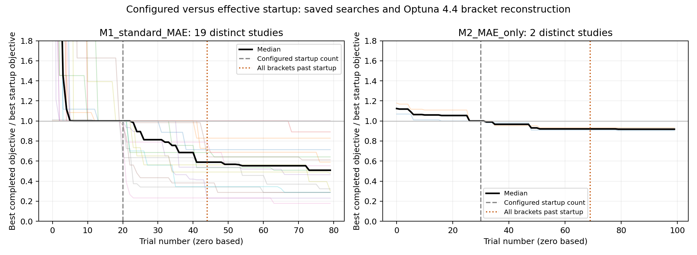

# M1 and M2 HPO review — 8 November 2026

The largest practical reductions are to fix M1's merge depth, embedding widths,
and weight decay during an initial screen, and to start M2 with one hidden layer.
There is little evidence that all encoder widths, kernels, or dropout values
converge to a single optimum. Keep learning rate and dropout in the search.

The concern about TPE is partly supported: M1 has few new records during the
actual TPE phase but meaningful gains in many studies; the two current-objective
M2 studies have almost no gain over their best random-sampled trials. Hyperband
also makes the effective startup substantially longer than the configured count.

## Scope and methodology

The inventory contains 211 CSV copies representing 129 distinct histories across
`outputs/DOE1/original` and the older DoE1 archive. The quantitative analysis uses
26 distinct recent original-pipeline studies: 19 M1 and 7 M2, containing 2,220
trials, of which 1,669 completed and 551 were pruned. The 103 other histories
remain in the inventory but are excluded from the parameter analysis.

No ProBayes histories are pooled into these recommendations. Exact file hashes
remove copied `best_overall`, `best_reference_run`, and run-folder histories.
The 26 selected histories also have distinct completed-parameter/value tables.

M1 studies all use three independent encoders and ordinary weight MAE training.
They span different split/training seeds and data layouts: 12 use divided Train
data with a 0.20 HPO validation fraction, 5 use divided Train data with 0.15,
and 2 use the earlier unified data with 0.15. Raw scores are not compared across
these settings when estimating parameter associations. Each study is ranked
internally; its best `ceil(0.20 * completed trials)` form the top quintile.

The **current on-disk M1 source and DoE1 configs still implement independent
per-signal encoders**. The proposed M1 config matches that implementation. These
histories cannot establish optimal CNN depth, kernel, or feature width for the
previously discussed encoder over time-concatenated signals.

M2 is split into 2 MAE-only studies (140 completed trials), which match current
MAE-only training and normalized-feature evaluation, and 5 older MAE-plus-L1
studies (363 completed trials). Their learned target features and objective
definitions differ. Older raw score magnitudes are not used to recommend ranges
for current M2. The historical `hpo_mean_mae` JSON key is not a reliable units
label; current code evaluates `mean_NMAE` in feature MinMax-scaled space.

The CSV summaries, top-quintile distributions, and correlations are observational:
TPE chooses samples adaptively; conditional parameters have missing values;
pruning selects which trials finish; initialization also changes by trial.
They identify useful screening choices, not causal proofs of irrelevance.
No final external-test results were used to choose recommendations.

## Is TPE actually improving the objective?

| Studies | Median gain after the configured startup boundary | Winners reconstructed as TPE-sampled | Median gain over the best reconstructed random trial |
|---|---:|---:|---:|
| M1, 19 studies | 49.1% | 16/19 | 18.0% |
| M2, current MAE-only, 2 studies | 8.2% | 1/2 | 0.32% |
| M2, older MAE plus L1, 5 studies | 2.7% | 4/5 | 2.7% |

M1 improves beyond the nominal startup boundary in 17/19 studies, with a median
of four new incumbent records. Once the actual sampler phase is reconstructed,
M1 has a median of only one new record from TPE-sampled trials. A small number
of improvements does not imply that their cumulative gain is small.

The last column compares the final best completed objective with the best
completed trial classified as random-sampled by the reconstruction. This is
descriptive, not a randomized TPE-versus-random experiment: the two sets contain
different trial counts and initialization seeds. The first and last columns
measure different things and must not be called the same "TPE improvement."



Each thin curve is a deduplicated study; black is the median. Scores are divided
by each study's best completed score before its configured startup boundary.
Values above the plotted y-axis limit in early trials are clipped visually, not
in the underlying CSV. Dashed gray lines mark configured startup, and dotted
orange lines mark when both brackets are reconstructed as past startup.

## The Hyperband and TPE setup deserves attention

The installed version is Optuna 4.4.0. Both models create an independent
`TPESampler` and `HyperbandPruner(min_resource=1, max_resource=3,
reduction_factor=3)`. This gives two brackets. Optuna filters observations by
bracket before invoking the sampler, so the configured startup requirement is
applied to each bracket, not just once across the whole study. This behavior is
documented in [Optuna 4.4 Hyperband](https://optuna.readthedocs.io/en/v4.4.0/reference/generated/optuna.pruners.HyperbandPruner.html)
and was verified against the installed `_filter_study` and `sample_independent`
implementations.

Reconstructing sequential trials using the saved study names and installed
bracket allocation gives:

| Model | Configured startup | First TPE trial in brackets 0 / 1, zero based | Total model-based trials |
|---|---:|---:|---:|
| M1 | 20 | 36 / 44 | 40 of 80 |
| M2 | 30 | 57 / 69 | 40 of 100 |

This is a source-based reconstruction, not recorded sampler telemetry. It
assumes the saved study names and sequential, terminal trials describe the
original execution. It explains why calling everything after trial 20 or 30
"TPE" is misleading. See [sampler_audit.csv](sampler_audit.csv).

There is also a resource-count mismatch: both objectives report `fold` as
`0, 1, 2`, while the pruner is configured for resources `1..3`. Bracket 0 first
checks its rung after step 1, i.e. after two folds; bracket 1's first rung at
step 3 is never reached. A follow-up implementation should report `fold + 1`
and avoid pruning after all folds are already finished, or evaluate a simpler
pruner appropriate to three fold-level reports. This audit does not change
the training implementation.

## M1: what to fix and what to keep searching

The current conditional space exposes up to 43 parameter columns and a median
of 33 sampled parameters per trial. Repeated copies of a winner are not evidence
of convergence; they are the same study exported into several directories.

| Parameter | Observed evidence | Recommendation for a cheaper first screen |
|---|---|---|
| `merge_n_layers` | One layer wins 16/19 studies and accounts for 215/242 top-quintile trials. Top-quintile rate is 25.7%, 10.0%, and 4.0% for 1, 2, and 3 layers. | Fix to **1**. Keep merge width searchable, e.g. **16–64**. Confirm one 2-layer challenger among finalists. |
| `weight_decay` | Top-quintile rates across four bins are roughly 19–23%; weak correlation and negligible held-out predictive importance. | Fix **1e-5** during screening; compare **1e-6 / 1e-5 / 1e-4** on finalists. This is not proof that weight decay has zero effect. |
| `pp_n_features` | Top-quintile rate stays roughly 20–21% across the full 4–15 range; winners range from 4 to 15. | Fix **8** initially. There is no evidence of convergence to one exact width. |
| Sensor `n_f_features` | Top-quintile 10th–90th percentiles span the full **2–6 per branch** range for all three signals; little predictive signal. | Fix **4 per branch**, i.e. **12 total** for this architecture. Revisit after changing encoder architecture or if Fusion remains limited. |
| Encoder pooling | Top-quintile values still span **2–4**, with weak univariate associations. | Fix **2** as a budget choice; its exact optimum is not established. |
| PP hidden stack | Lower predictive signal than merge architecture, dropout, or learning rate. PP depth 3 nevertheless has a better observed top-quintile rate than depths 1–2. | Use **[16, 16]** for the initial screen; include a 3-layer challenger before finalizing. The fixed stack is a cost choice. |
| Encoder depth | Signal p1 is relatively flat across 1–3; p2's 2-layer trials perform better; T1's 3-layer trials perform better. | The branch-preserving candidate fixes depths **2 / 2 / 3** to remove conditional dimensions. Do not transfer this finding directly to a single concatenated encoder. |
| Encoder channels and kernels | Good trials cover almost the full channel **8–32** and kernel **3–15** ranges. No narrow optimum is established. | Retain channel search **8–32**. The candidate fixes kernel **5** solely to reduce cost; reopen kernels if the reduced screen loses performance. |
| `batch_size` | Smaller batches are enriched among good trials, but winners range **16–62**. | Candidate fixes **32** for cost control. Compare **16 / 32 / 64** on finalists; do not call batch size irrelevant. |
| `lr` | Stronger association with quality. Top-quintile 10th–90th percentiles are **4.19e-4–2.64e-3**. One older unified-data winner uses 1.53e-4. | Keep searching **2e-4–3e-3** initially, and retain a lower-rate challenger when training longer. |
| `dropout` | Nonmonotonic behavior and meaningful predictive signal; study winners range **0.0016–0.241**. | Keep **0–0.25**. The saved trials do not justify fixing it to a single value. |

A grouped random-forest surrogate, evaluated with entire studies held out,
predicts within-study ranks with mean R² about **0.36**. Its grouped permutation
ranking is merge architecture, dropout, learning rate, CNN architecture, batch
size, then PP architecture. PP embedding width, weight decay, and sensor feature
widths add little predictive signal. Conditional depths and all dependent layer
parameters are shuffled together to avoid impossible layer-presence patterns.
The modest predictive R² and observational sampling limit how confidently small
differences can be interpreted. Negative tiny importance estimates mean no
detectable held-out predictive contribution, not a beneficial negative effect.

## M2: use the histories compatible with current training

In the two MAE-only studies, all **29 top-quintile trials use one hidden layer**.
There are 81 completed one-layer trials versus 59 deeper trials; deeper trials
are not completely absent. Both study winners are one-layer networks.

Start with `n_layers=1`, `hidden_size=[16,128]`, and
`lr=[0.001,0.008]`. Fix batch size to 64 for the initial screen. These are
screening bounds, not a guarantee that a narrower network is optimal.

Keep dropout **0–0.4**: the two winners use about **0.001 and 0.332**. Keep weight
decay broad, e.g. **1e-5–1e-2**: the winners use approximately **1.07e-4 and
9.995e-3**, including one at the old upper boundary. Weight decay cannot be
declared irrelevant for current M2. Hidden width also does not converge to one
number: the winners' first widths are 24 and 85.

Older L1-regularized M2 studies often prefer deeper or wider networks. They are
not a reason to retain five layers in the current initial screen. No surrogate
importance is fitted to the current M2 cohort because two independent studies
are insufficient for a credible held-out-study importance estimate.

## Improving M1 beyond shrinking the space

1. **Use a staged budget.** Screen 40–60 configurations, then reevaluate 2–3
   finalists with 150–200 epochs and three initialization seeds, keeping the
   same group-safe splits. Of the 726 top-quintile M1 trial/fold fits, **71.8%**
   hit the 80-epoch HPO cap and **64.3%** achieve their best validation score in
   epochs 61–80. Do not reduce the epoch cap further merely to speed up HPO.
   These data do not prove that training beyond 80 improves generalization;
   they show the current rankings may be influenced by the short budget.
2. **Treat initialization as noise.** Both objectives change the model seed by
   `trial.number * 13`. A trial's improvement therefore combines hyperparameter
   changes and initialization changes. Repeated-seed finalists are more useful
   than interpreting one unusually good trial as a precise optimum. Fix the
   sampler seed for reproducible search comparisons.
3. **Address sampler/pruner overhead.** Lower startup to 10 after reducing the
   dimension count, or evaluate a single-bracket/median-pruning scheme. Consider
   `TPESampler(multivariate=True, group=True)` as an experiment for parameter
   interactions and conditional spaces; it is not guaranteed to beat the
   existing sampler. See [Optuna 4.4 TPE](https://optuna.readthedocs.io/en/v4.4.0/reference/samplers/generated/optuna.samplers.TPESampler.html).
   These options require a source change; adding unused config keys would not
   enable them.
4. **Test learning-rate decay on finalists.** The saved/current configs use
   `scheduler_factor=1`, so the existing conditional scheduler step is disabled.
   A controlled trial with factor 0.5 is a reasonable next experiment; the
   histories do not measure its benefit because it was held constant.
5. **Validate fixed choices rather than freezing everything permanently.**
   After the reduced screen, vary one fixed group at a time using the same
   splits and seeds. Reopen the group if its change consistently beats the
   observed seed-to-seed variation. Use development validation for these
   decisions and keep independent final tests out of repeated tuning.

## Proposed files and validation

- [M1_candidate_config.json](M1_candidate_config.json): a **10-dimensional**
  branch-preserving screen with fixed 2/2/3 encoder depths, rather than up to
  43 possible sampled parameters. Sixty trials, ten startup observations per
  bracket, explicit sampler seed 42, and a new study name.
- [M2_candidate_config.json](M2_candidate_config.json): a **4-dimensional**
  one-layer screen (width, learning rate, weight decay, dropout). Sixty trials,
  ten startup observations per bracket, explicit sampler seed 42, and a new
  study name.

The candidate configs were parsed through the current production suggestion
functions and five sampled architectures per model were constructed and given
forward passes. The proposed dimensions were verified as 10 and 4. This checks
that the configs work; it does **not** establish that they outperform the active
configs. No full training or HPO run was launched and active configs were not
modified. See [candidate_validation.json](candidate_validation.json).

Supporting outputs: [study summary](study_summary.csv), [deduplication manifest](study_manifest.csv),
[parameter distributions](parameter_summary.csv), [parameter bins](parameter_bins.csv),
[predictive importance](predictive_importance.csv), [training dynamics](m1_training_dynamics.csv),
[sampler reconstruction](sampler_audit.csv), and [completed trials](completed_trials.csv).

Reproduce the audit from the repository root:

```bash
PYTHONDONTWRITEBYTECODE=1 MPLCONFIGDIR=/tmp/im-ml-matplotlib \
  .venv/bin/python reports/hpo_review_2026-11-08/analyze.py
```
